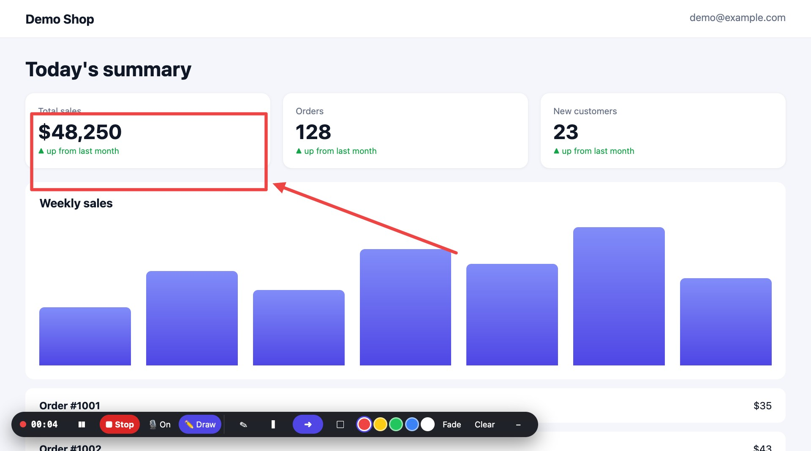

# Snap5

Screenshots, markup and screen recording for Google Chrome (built for Mac, no account, no server).

- Press `5 5`: select an area, mark it up, copy or download
- Press `5 5 5`: capture the full page and copy it
- Press `⌥⇧R`: open the screen recorder, or stop recording

**[⬇️ Download Snap5 (free)](https://github.com/leoarafat/snap5/releases/latest/download/Snap5.zip)** · [User guide (PDF)](docs/Snap5-Guide.pdf)

## Screen recorder

- Screen, window or tab; screen with camera bubble; camera only; region crop
- Microphone and tab sound, noise reduction, live mute
- Up to 4K, 15/30/60 fps, MP4 (H.264 + AAC) or WebM
- Countdown, pause and resume, auto stop, floating controls, draw on web pages, click highlight, shortcut display
- Trim, frame screenshot, download, library, and recovery of interrupted recordings

## Mac app (screenshots in any app)

**[⬇️ Download Snap5 for Mac (free)](https://github.com/leoarafat/snap5/releases/download/mac-v1.0.0/Snap5-Mac.zip)** · Apple silicon, macOS 14 or later (tried on macOS 27 only)

A menu bar app that takes `5 5` / `5 5 5` screenshots outside Chrome, with the same markup tools.

1. Unzip and drag **Snap5** to **Applications**.
2. Open it. macOS blocks it because Apple has not checked (notarized) it. Click **Done**, then **System Settings → Privacy & Security → Open Anyway**. Only do this if you trust this download.
3. Allow **Screen & System Audio Recording**, **Input Monitoring** and **Accessibility**, then quit and reopen Snap5.

Full steps: Part 2 of the [user guide](docs/Snap5-Guide.pdf). To build it yourself: [mac/README.md](mac/README.md).

## Install the Chrome extension

1. [Download `Snap5.zip`](https://github.com/leoarafat/snap5/releases/latest/download/Snap5.zip) and unzip it. Keep the `Snap5` folder somewhere permanent. (Use this file, not the green **Code** button.)
2. Open `chrome://extensions` and turn on **Developer mode**.
3. Click **Load unpacked** and choose the `Snap5` folder.
4. Pin Snap5 from the puzzle-piece menu.

Full instructions with pictures: [docs/Snap5-Guide.pdf](docs/Snap5-Guide.pdf)

## Features

- Capture: area, element, visible part, full page, timer, whole screen or another app
- Markup: arrow, shapes, line, pen, highlighter, text, step numbers, blur, pixelate, black out, spotlight, magnify, ruler, emoji, color picker
- Editor: crop, rotate, resize, beautify, watermark, image layers, QR reader
- Output: clipboard, PNG, JPG, WebP, PDF, print, share, pin to screen, history

## Limits

- `5 5` is ignored while typing in a text box (on purpose). Use `⌥⇧S`.
- Chrome does not allow extensions to run on `chrome://` pages, the Web Store or the New Tab page.
- Floating controls and drawing work on web pages only.
- No OCR, captions, GIF export or online share links.

## Code

- `content/trigger.js`: key sequence detection
- `background.js`: capture and full page stitching
- `content/overlay.js`: selection UI
- `lib/annotator.js`, `lib/toolbar.js`: markup engine shared by the overlay and the editor
- `pages/recorder*.js`, `pages/compositor-worker.js`, `content/rec-toolbar.js`: screen recorder
- `pages/`: editor, popup, settings, history

No build step and no third-party libraries.
