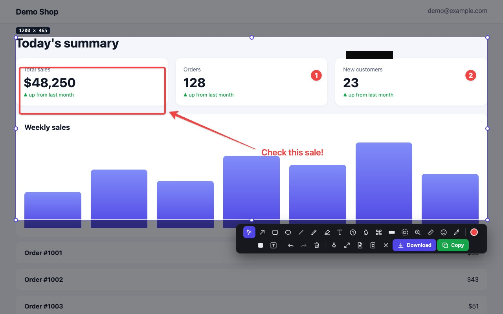

# Snap5

A fast screenshot and markup extension for Google Chrome (built for Mac, no account, no server).

- Press `5 5`: select an area, mark it up, copy or download
- Press `5 5 5`: capture the full page and copy it

**[⬇️ Download Snap5 (free)](https://github.com/leoarafat/snap5/releases/latest/download/Snap5-1.0.0.zip)** · [User guide (PDF)](docs/Snap5-Guide.pdf)

## Install

1. [Download `Snap5-1.0.0.zip`](https://github.com/leoarafat/snap5/releases/latest/download/Snap5-1.0.0.zip) and unzip it. Keep the `Snap5` folder somewhere permanent. (Use this file, not the green **Code** button.)
2. Open `chrome://extensions` and turn on **Developer mode**.
3. Click **Load unpacked** and choose the `Snap5` folder.
4. Pin Snap5 from the puzzle-piece menu.

Full instructions with pictures: [docs/Snap5-Guide.pdf](docs/Snap5-Guide.pdf)

## Features

- Capture: area, element, visible part, full page, timer, whole screen or another app
- Markup: arrow, shapes, line, pen, highlighter, text, step numbers, blur, pixelate, black out, spotlight, magnify, ruler, emoji, color picker
- Editor: crop, rotate, resize, beautify, watermark, image layers, QR reader
- Output: clipboard, PNG, JPG, WebP, PDF, print, share, pin to screen, history

## Limits

- `5 5` is ignored while typing in a text box (on purpose). Use `⌥⇧S`.
- Chrome does not allow extensions to run on `chrome://` pages, the Web Store or the New Tab page.
- No screen video recording and no OCR.

## Code

- `content/trigger.js`: key sequence detection
- `background.js`: capture and full page stitching
- `content/overlay.js`: selection UI
- `lib/annotator.js`, `lib/toolbar.js`: markup engine shared by the overlay and the editor
- `pages/`: editor, popup, settings, history

No build step and no third-party libraries.
